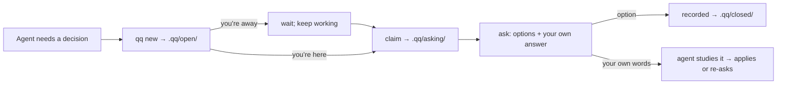

<p align="center">
  
</p>

<h1 align="center">qq</h1>

<p align="center">
  <b>Your coding agent asked you something an hour ago. You never saw it, and it's been frozen ever since.</b><br>
  qq is the question queue for coding agents: questions wait as cards until you're back, each is asked exactly once, and your answer is never lost.
</p>

<p align="center">
  <a href="https://github.com/bartawilly/qq/actions/workflows/test.yml"></a>
  <a href="LICENSE"></a>
  <a href="https://github.com/bartawilly/qq/releases"></a>
</p>

## Sound familiar?

- **You stepped away, and everything stopped.** Your agent opened a question box, froze until you came back, and so did everything it was running.
- **The question scrolled away.** It was asked in chat, buried in a long transcript or lost in a context compaction, and never asked again.
- **Two sessions asked you the same thing.** Worded differently, so now you have two different answers on record.
- **You came back to "Approve option B for PROJ-482?"** No context, no example, no idea.
- **None of the options fit.** And there was nowhere to say "neither, and here's why".

## What qq does

Every question becomes a **card**: a small Markdown file in your project's `.qq/` folder.

| | |
|---|---|
| **Asked when you're here** | Cards wait while you're away. Nobody freezes, and other work keeps moving. |
| **Asked once** | A card is claimed by an atomic file move before it's asked, so parallel sessions can't double-ask: automatically with the Claude Code plugin, through `qq claim` elsewhere. |
| **Asked properly** | Every card says what happens today, who it affects, gives an example with numbers, and makes an honest recommendation. |
| **Your words count** | Every question keeps a free-text answer. Pick an option, add a condition, or push back: the agent studies what you said and re-asks if needed. |
| **Nothing lost** | Your answer is written into the card, word for word. |

## Install

**Claude Code: the full version** (skill, CLI and the hooks that enforce it):

```text
/plugin marketplace add bartawilly/qq
/plugin install qq@qq
```

**Any agent: Codex, Cursor, Gemini CLI, Claude Code and more** (skill and CLI, through [skills.sh](https://skills.sh)):

```bash
npx skills add bartawilly/qq -g      # -g: for your user, in every project
```

| You get | Plugin (Claude Code) | skills.sh (any agent) |
|---|:-:|:-:|
| Card template, rules and the `qq` CLI | ✅ | ✅ |
| Atomic claim, so a card is never asked twice | ✅ automatic | ✅ via `qq claim` |
| Question boxes refused while you're away | ✅ | — |
| Answers recorded automatically | ✅ | — via `qq answer` |
| Reminders when you come back | ✅ | — |

Restart your sessions afterwards, so they load the hooks.

**Then turn it on in a repository.** qq is opt-in, so nothing changes anywhere else:

```text
/qq init          # Claude Code plugin
```

With any other agent, just ask it: *"use qq in this repo"* (it runs `qq.py init` from the skill).

Other commands: `/qq list` (it also shows whether the hooks are active, and why not), `/qq away` before you step out, `/qq back`, and `/qq off` to pause qq in a repository.

Installed through skills.sh into Claude Code? Run `python3 ~/.agents/skills/qq/scripts/qq.py setup` once to add the hooks. It backs up your settings first, and `setup --remove` undoes it.

Needs Python 3.10+ as `python3`, and nothing else. Tested on macOS and Linux; Windows is untested. On a fresh Mac, `python3` may first prompt you to install Apple's command-line tools.

## A card

```markdown
# Q0007 · Should the free plan keep CSV export?
- Owner: api-agent (billing work)
- Filed: 2026-11-24 13:07
- Blocks: the pricing-page PR

## Today, step by step
Every plan can export CSV. The new Pro plan was meant to include it as a paid perk.

## Who meets it, and how often
About 300 free users export each month; 12 of them upgraded last month after asking about limits.

## Example (example numbers)
Maya runs a 3-person team on the free plan and exports weekly. With option 1 she sees
"CSV export is a Pro feature" and a $9/month upgrade; with option 2, nothing changes.

## Options
1. Move CSV export to Pro (Recommended): free users see an upgrade prompt; roughly +$100/month if 1 in 30 upgrade.
2. Keep it free: no change, no new revenue, and Pro stays harder to sell.

## Recommendation: option 1 · leaning
- Why: a clear Pro reason at a real moment of need, without removing data people already have.
- What would change my mind: if exports are mostly compliance downloads people can't skip.
```

## How it works



[docs/design.md](docs/design.md) covers how presence is detected, who asks which card, and the safety rules: every hook fails open, and qq never answers a box for you.

## Configure

| Variable | Default | Meaning |
|---|---|---|
| `QQ_AWAY_MINUTES` | `60` | No typed message for this long means you're away |
| `QQ_MIN_QUESTION` | `120` | Minimum question length, so it carries context |
| `QQ_MIN_OPTION` | `60` | Minimum length of each option's explanation |
| `QQ_OWNER` | | Default owner name for `qq new` |
| `QQ_DIR` | | Use this folder as the queue instead of finding `.qq/` |

Set them in your shell, or for Claude Code in `~/.claude/settings.json` under `"env"`.

`qq off` turns the hooks off in one project, and `qq on` turns them back on. Linked git worktrees share the main worktree's queue, so parallel sessions in worktrees still never double-ask.

**To uninstall:** `/plugin uninstall qq@qq` (or `qq.py setup --remove` for a skills.sh install), then delete the `.qq/` folders you no longer need.

## What qq doesn't do

- **No inbox app, no server, no account.** Cards are plain files you can read in any editor.
- **Nothing in repositories you didn't opt in.** qq acts only on queues you created with `qq init` or `qq new`; it keeps their list in `~/.config/qq/`. A `.qq/` that arrives with a clone or a download is ignored, so nobody can plant questions in your sessions. If one is yours, trust it from a normal terminal with `qq init --trust-existing` (it asks you to type the path).
- **No enforcement outside Claude Code (yet).** Other agents follow the protocol through the skill and CLI. Hook support for Codex is the next step.
- **Never answers for you.** The hooks only ever refuse a question box. They never fill one in.

## Contributing

Issues and PRs are welcome; see [CONTRIBUTING.md](CONTRIBUTING.md). Run the tests with `python3 tests/test_qq.py`.

## License

[MIT](LICENSE)
